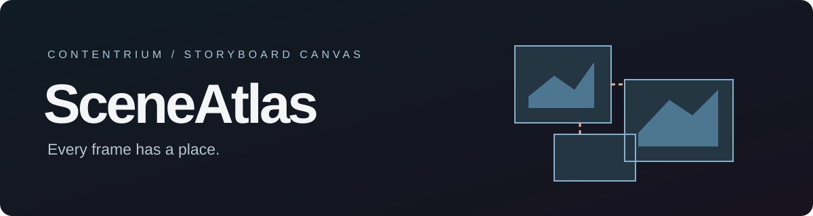

# SceneAtlas

장면 이미지와 설명, 대사·자막·나레이션을 자유 캔버스에 정리하고 PDF로 내보내는 Windows 스토리보드 앱입니다. 기존 Scene Board의 새 표시 이름이며 `.storyboard` 프로젝트는 그대로 열립니다.

**[설치형 다운로드](https://github.com/contentriumkorea/scene-board/releases/latest/download/SceneBoard-1.7.7-Windows-Setup.exe)** · **[포터블 다운로드](https://github.com/contentriumkorea/scene-board/releases/latest/download/SceneBoard-1.7.7-Windows.zip)**

설치 파일과 실행 파일에는 기존 업데이트 호환성을 위해 SceneBoard·CONTENTRIUM BOARD 이름이 남아 있습니다.

## Download

[전체 릴리스 보기](https://github.com/contentriumkorea/scene-board/releases/latest)

- For a first-time installation, extract `SceneBoard-version-Windows-Installer.zip` and run `SceneBoard-Setup.exe`. You can also download and run `Windows-Setup.exe` directly.
- Supports Windows x64 and installs for the current Windows user.
- The installer is not code-signed, so Windows may show an unknown publisher warning.
- `latest.yml` and `.blockmap` are used for automatic updates. Do not run them separately.

## Updating the app

In the installed app, select **Check for updates** → **Download update** → **Save, update, and restart**. If you use version 1.7.0, use the existing update button at the bottom right to get a newer version. The app also checks for updates at startup, but you choose whether to download and install them.

If you cancel the save or it fails, installation does not continue. Updates preserve your `.storyboard` projects, footage folders, and existing autosave paths. An internet connection is required to download updates; ordinary editing works offline.

**Portable users must switch to the installer once to receive in-app updates.** The portable EXE and ZIP run separately and do not support automatic app updates.

## Features

- Black freeform canvas with scenes you can add, move, resize, and snap
- Drag on empty space to select multiple items, Shift to add to the selection, and Space+drag to pan
- Short group-name field and a Check for updates button at the top
- Since 1.7.3: release notes by version, the ability to keep working after a download, and final confirmation before installation (default: Later)
- The new release-notes list and final confirmation are available after installing 1.7.3
- Change image-node header and border colors, and restore defaults (1.7.2 TEST)
- Save, duplicate, and undo node colors while preserving the original image
- Input rows for images, scene descriptions, dialogue, subtitles, and narration
- Note stickers, persistent nested-group names, group prompts, and group connections
- Save copies of images in the project footage folder
- Export images, scene descriptions, subtitles, dialogue, and narration to a tabular PDF
- Support for 16:9, 4:3, 3:4, 9:16, and 1:1 aspect ratios

## Distribution and privacy

This repository distributes installers, update metadata, and usage instructions. It does not include development source code, user projects, or images. The app connects to GitHub to check for and download updates; it does not upload your working files to an update server.

Update downloads use HTTPS and SHA-512 metadata verification. A file hash check does not replace Windows publisher code signing.

New versions are published as official GitHub Releases in this repository. Editing the source or committing to GitHub alone does not update an installed app. To make an update available in the app, publish a higher-version installer together with its matching `latest.yml` and `.blockmap`.

